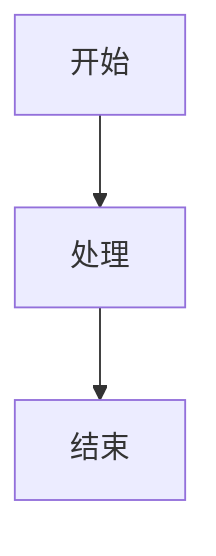

# Scholia 人工测试验收文档

**版本**：0.1.0  
**适用场景**：每次发布前、重大功能变更后执行  
**预计时长**：约 30 分钟（完整）/ 15 分钟（快速通道）

---

## 前置准备

### 测试数据

**视频内容**：至少一个 VDL 处理过的任务目录，例如：

```
~/vdl-work/
  <taskId>/
    meta.json          # 必需
    article.md         # 用于测试 AI 文章阅读
    subtitles.json     # 用于测试字幕
    media/
      video.mp4        # 可选，用于测试视频播放
```

**文章内容**：至少两个 Markdown 文件：

```
~/test-articles/
  intro.md             # 带 frontmatter（title + date）
  deep-dive.md         # 无 frontmatter，含 Mermaid 图表
  2024/sub-note.md     # 子目录，用于测试 slug 生成
```

`deep-dive.md` 示例（含 Mermaid）：

````markdown
# 深度解析

段落一内容。



段落二内容，较长，用于测试 TOC。
````

### 启动

```bash
scholia config set work-dir ~/vdl-work
scholia config set content-dir ~/test-articles
scholia serve --open
```

确认终端打印 `Scholia running at http://localhost:7654?token=...`，浏览器自动打开。

---

## 模块一：基础启动与导航

| # | 操作 | 期望结果 | 结果 |
|---|------|----------|------|
| 1.1 | 打开首页 | 显示「视频」和「文章」两个 Tab | ☐ |
| 1.2 | 切换到「视频」Tab | 显示视频卡片列表，有标题和来源 URL | ☐ |
| 1.3 | 切换到「文章」Tab | 显示文章卡片列表，有标题和日期 | ☐ |
| 1.4 | 搜索框输入关键词 | 当前 Tab 的列表实时过滤 | ☐ |
| 1.5 | 清空搜索 | 列表恢复完整显示 | ☐ |
| 1.6 | ⌘K 快捷键 | 搜索框聚焦 | ☐ |
| 1.7 | 无 Token 直接访问 `/api/tasks` | 返回 401 | ☐ |

---

## 模块二：视频详情

| # | 操作 | 期望结果 | 结果 |
|---|------|----------|------|
| 2.1 | 点击视频卡片进入详情页 | 页面正常加载，显示标题 | ☐ |
| 2.2 | 有媒体文件时 | 视频播放器显示，可点击播放 | ☐ |
| 2.3 | 无媒体文件时 | 进入 mode E（纯阅读），不显示播放器 | ☐ |
| 2.4 | AI 文章区域 | article.md 内容正常渲染 | ☐ |
| 2.5 | 字幕区域 | subtitles.json 存在时显示字幕列表 | ☐ |
| 2.6 | 视频播放时 | 当前字幕高亮，随播放进度同步 | ☐ |
| 2.7 | 点击字幕条目 | 视频跳转到对应时间戳 | ☐ |
| 2.8 | 返回首页 | 正常导航，列表保持之前状态 | ☐ |

---

## 模块三：文章详情

| # | 操作 | 期望结果 | 结果 |
|---|------|----------|------|
| 3.1 | 点击文章卡片进入详情页 | Markdown 正常渲染，无播放器 | ☐ |
| 3.2 | 含 frontmatter 的文章 | 标题显示 frontmatter 中的 title | ☐ |
| 3.3 | 无 frontmatter 的文章 | 标题从文件名推导（deep-dive → Deep Dive） | ☐ |
| 3.4 | Mermaid 图表 | 图表正常渲染，不显示为原始代码 | ☐ |
| 3.5 | TOC 导航 | 左侧或右侧显示标题列表，点击跳转 | ☐ |
| 3.6 | 子目录文章（2024/sub-note.md） | slug 正确显示为 `2024-sub-note` | ☐ |

---

## 模块四：高亮

| # | 操作 | 期望结果 | 结果 |
|---|------|----------|------|
| 4.1 | 在文章中选中一段文字 | 出现高亮操作弹窗 | ☐ |
| 4.2 | 选择黄色高亮 | 文字背景变黄，高亮持久化 | ☐ |
| 4.3 | 选择绿色高亮 | 文字背景变绿 | ☐ |
| 4.4 | 选择红色高亮 | 文字背景变红 | ☐ |
| 4.5 | 选择蓝色高亮 | 文字背景变蓝 | ☐ |
| 4.6 | 刷新页面 | 高亮仍然存在（持久化验证） | ☐ |
| 4.7 | 点击已有高亮 | 出现删除选项 | ☐ |
| 4.8 | 删除高亮 | 高亮消失，刷新后不再出现 | ☐ |
| 4.9 | 视频 AI 文章中高亮 | 同上述流程，均正常 | ☐ |

---

## 模块五：笔记

| # | 操作 | 期望结果 | 结果 |
|---|------|----------|------|
| 5.1 | 在内容中触发笔记入口 | 出现笔记输入区域 | ☐ |
| 5.2 | 输入笔记内容并保存 | 笔记绑定到当前段落/位置 | ☐ |
| 5.3 | 刷新页面 | 笔记仍然存在 | ☐ |
| 5.4 | 编辑已有笔记 | 内容更新，刷新后保持 | ☐ |
| 5.5 | 删除笔记 | 笔记消失，刷新后不再出现 | ☐ |

---

## 模块六：配置与 CLI

| # | 操作 | 期望结果 | 结果 |
|---|------|----------|------|
| 6.1 | `scholia config set work-dir ~/path` | 终端打印 `work-dir = ~/path` | ☐ |
| 6.2 | `scholia config get work-dir` | 打印设置的路径 | ☐ |
| 6.3 | `scholia config get content-dir`（未设置） | 打印 `(not set)` | ☐ |
| 6.4 | `scholia config set unknown-key val` | 打印错误信息并 exit 1 | ☐ |
| 6.5 | `scholia serve --port 8080` | 在 8080 端口启动，URL 正确 | ☐ |
| 6.6 | 端口已占用时启动 | 不报错退出，自动改用空闲端口，打印 `Port 8080 was in use; using <M> instead.` | ☐ |
| 6.7 | `scholia serve --open` | 浏览器自动打开 | ☐ |
| 6.8 | 未知命令 `scholia foo` | 打印 usage 并 exit 1 | ☐ |
| 6.9 | `scholia start` | 后台启动，终端立即返回并打印 `Scholia started (pid ..., port ...)`；关闭终端服务不受影响 | ☐ |
| 6.10 | 已有实例时 `scholia start` | 打印 `Scholia is already running (pid ..., port ...)` 并 exit 1 | ☐ |
| 6.11 | `scholia stop`（停止 `start` 启动的实例） | 打印 `Stopped scholia (pid <pid>, port <port>).`，进程实际退出 | ☐ |
| 6.12 | 未运行时 `scholia web` | 打印 `Scholia is not running. Run "scholia start" first.` 并 exit 1 | ☐ |
| 6.13 | `scholia start` 后执行 `scholia web` | 浏览器打开对应实例的 URL（带正确 token） | ☐ |

---

## 模块七：边界与容错

| # | 操作 | 期望结果 | 结果 |
|---|------|----------|------|
| 7.1 | `work-dir` 未配置时启动 | 服务正常启动，视频列表为空（不崩溃） | ☐ |
| 7.2 | `content-dir` 未配置时启动 | 服务正常启动，文章列表为空 | ☐ |
| 7.3 | `work-dir` 指向空目录 | 视频 Tab 显示「暂无视频」 | ☐ |
| 7.4 | `content-dir` 指向空目录 | 文章 Tab 显示「暂无文章」 | ☐ |
| 7.5 | 访问不存在的任务 ID | 返回 404 或显示错误页 | ☐ |
| 7.6 | 搜索无结果 | 显示「无匹配结果」，不崩溃 | ☐ |

---

## 模块八：语音评论

语音评论要真实的 CocoScribe.app 和麦克风，自动化测试覆盖不到，只能真机逐条跑。

### 前置

- CocoScribe.app ≥ 7.1.0 已启动（失败后的「重试」依赖 7.1.0 起才有的重新处理接口）。
- CocoScribe 设置里已配好理解模型（Ollama），并先在 CocoScribe 自己的界面里用整理模式录一段，确认能出整理后的文字。
- 只用临时目录里的文章副本。语音评论会往原文里写 sc 标记，所以不要指向真实的内容目录或视频工作目录，也不要运行 `scholia config set`，配置用 `SCHOLIA_CONFIG_FILE` 重定向到临时文件：

```bash
T=$(mktemp -d /tmp/scholia-voice-XXXX)
mkdir -p "$T/articles"
cp ~/test-articles/intro.md "$T/articles/"       # 复制，不要链接；任选一两篇有多段正文的文章
cp -R "$T/articles" "$T/before"                  # 原样留一份，用来 diff
printf 'CONTENT_DIR=%s\n' "$T/articles" > "$T/settings.conf"

# 在本分支的仓库根目录：
(cd web && npm run build)
SCHOLIA_CONFIG_FILE="$T/settings.conf" node cli/index.js serve --port 7777 --open
```

下面的「原文」「评论文件」分别指 `$T/articles/intro.md` 和 `$T/articles/intro/notes.json`。测完 Ctrl-C 停服务，`rm -rf "$T"`。

| # | 操作 | 期望结果 | 结果 |
|---|------|----------|------|
| 8.1 | 先确认 SDK 的阶段顺序（spec「未确认项」第一条）：在仓库根目录跑下方脚本，听到开始后说一句话，3 秒后自动结束 | 输出里 `phase recording` 出现在任何 `transcribing` 之前（之前可能有 `starting`），之后依次是 `transcribing`、`refining`、`completed`，最后打印整理后的文字。**把完整的阶段顺序原样抄进结果列或缺陷记录**；若没有 `recording`，Scholia 的开始请求会一直挂到会话结束，记为严重缺陷。脚本以退出码 2 结束 = 15 秒内没有 `recording` 阶段，把已打印的阶段原样抄进缺陷记录 | ☐ |
| 8.2 | 文章详情页（内嵌视图）选中一句话，按 `v` | 1 秒内正文滚动区顶部出现录音条「录音中 0:0x · 评论「所选文字」」，计时在走；所选文字变成珊瑚色虚线底；macOS 麦克风指示灯亮 | ☐ |
| 8.3 | 说一句话，再按 `v`（或点「结束并保存」） | 录音条消失；所选文字所在段落下方出现占位卡片，依次显示「**转写中…** → 整理」（青色）和「转写 → **整理中…**」（靛紫），右侧是录音时长；完成后占位卡片变成普通评论卡片，绿色描边闪一下 | ☐ |
| 8.4 | 核对 8.3 的结果：看卡片正文，打开评论文件，`diff -u "$T/before/intro.md" "$T/articles/intro.md"` | 卡片正文是整理后的文字（不是原始转写）；评论文件新增一条，`body` 同卡片正文、`anchor` 是所选原文、带 `markerId`；diff 只多出包住所选文字的 `<!-- sc:<markerId> -->` 和 `<!-- /sc:<markerId> -->`（选区从行首开始时只有结尾那一个），没有别的改动 | ☐ |
| 8.5 | 点评论：在一段文字中间单击放下光标（不选文字），按 `v`，说一句话，再按 `v` | 录音条显示「评论「插入点」」，光标处出现珊瑚色评论图标；结束后同 8.3，阶段依次出现，最后变成普通评论卡片 | ☐ |
| 8.6 | 核对 8.5 的结果，同 8.4 的方法 | 卡片正文是整理后的文字；评论文件新增一条，`anchor` 为空、带 `prefix`/`suffix`/`position` 和 `markerId`；diff 只在光标处多出一个 `<!-- sc:<markerId> -->` | ☐ |
| 8.7 | 停掉 Ollama（菜单栏 Ollama → Quit Ollama；命令行启动的用 Ctrl-C），`curl -s localhost:11434` 连不上后，再做一次选区语音评论 | 「转写中…」之后，卡片变成失败态：红色「转写或整理失败」，提示「录音还在 CocoScribe 里，重试不用重录」，有「重试」和「丢弃」。若直接成功（CocoScribe 退回原始转写）或没有「重试」，把实际表现记入缺陷记录 | ☐ |
| 8.8 | 重新启动 Ollama，点「重试」 | 麦克风指示灯不亮（不重新录音）；卡片回到「转写中…」→「整理中…」，然后变成普通评论卡片，正文是整理后的文字；评论文件只多一条，原文只多一组标记 | ☐ |
| 8.9 | 退出 CocoScribe（菜单栏 → Quit），不刷新页面，选中文字按 `v` | 页面底部居中出现轻提示「CocoScribe 未运行，语音评论暂不可用」，约 3 秒后消失；不出现录音条；之后工具条麦克风按钮置灰 | ☐ |
| 8.10 | 刷新页面，选中文字 | 工具条麦克风按钮一开始就是灰的，悬停出现「CocoScribe 未运行」；右键菜单的「语音评论」置灰并带同样提示；按 `v` 出现同 8.9 的轻提示 | ☐ |
| 8.11 | 仍不开 CocoScribe，用工具条评论按钮、右键「在此处评论」各写一条评论并保存，刷新 | 两条手动评论都正常保存，刷新后仍在 | ☐ |
| 8.12 | 重新打开 CocoScribe；浏览器开发者工具 Console 执行 `localStorage.removeItem('voice-hint-dismissed')`，刷新，开始一段语音评论 | 录音条下方出现一次性提示：请在 CocoScribe 设置里关掉「转录完成后弹出编辑窗口」和「Copy transcript to clipboard」；点「知道了」后提示消失，录音继续 | ☐ |
| 8.13 | 按 `Esc` 取消这段录音，再开始一段；然后刷新页面再开始一段 | 两次都不再出现那条提示；`Esc` 取消后录音条消失、不出占位卡片、评论文件不变 | ☐ |
| 8.14 | 开始一段选区语音评论，说一句话后按 `v`，看到「转写中…」占位卡片就立刻关闭标签页 | 标签页正常关闭，无报错弹窗；本步不单独判定，结果由 8.15 判定 | ☐ |
| 8.15 | 等 30 秒左右，重新打开该文章 | 评论在（服务端保存不依赖页面是否还开着），正文是整理后的文字，正文里锚点仍标在所选文字上。sc 标记是页面在保存成功后补写的，页面已关时原文没有新标记、评论文件里这条没有 `markerId` 属正常，评论按文字定位 | ☐ |

8.1 的脚本（参数和 Scholia 开始语音评论时一致；要在装了依赖的仓库根目录跑，SDK 才能被找到）：

```bash
node -e '
const { CocoScribeClient } = require("@harveyzhang814/host-client");
const t0 = Date.now(), log = (...a) => console.log(String(Date.now() - t0).padStart(6), ...a);
const s = new CocoScribeClient().startSession({ mode: "comprehend", silent: true, awaitEdit: false });
const kill = setTimeout(() => { log("no recording phase within 15s, cancelling"); s.cancel().catch(() => {}); process.exit(2); }, 15000);
s.on("phase", (p) => { log("phase", p); if (p === "recording") { clearTimeout(kill); setTimeout(() => s.stop(), 3000); } });
s.on("completed", (r) => { log("completed", JSON.stringify(r.text)); process.exit(0); });
s.on("failed", (e) => { log("failed", e.code, e.message); process.exit(1); });
s.on("error", (e) => { log("error", e.message); process.exit(1); });
'
```

---

## 快速通道（回归验证，约 15 分钟）

覆盖最高风险场景，非完整测试：

- [ ] 1.1 — 首页两个 Tab 正常显示
- [ ] 2.1 + 2.4 — 视频详情 + AI 文章渲染
- [ ] 3.1 + 3.4 — 文章详情 + Mermaid 渲染
- [ ] 4.2 + 4.6 — 高亮创建并持久化
- [ ] 5.2 + 5.3 — 笔记创建并持久化
- [ ] 6.1 + 6.5 — config set + serve --port
- [ ] 7.1 — 无配置启动不崩溃

---

## 缺陷记录

| 编号 | 模块 | 步骤 | 实际结果 | 严重度 | 状态 |
|------|------|------|----------|--------|------|
| | | | | | |
