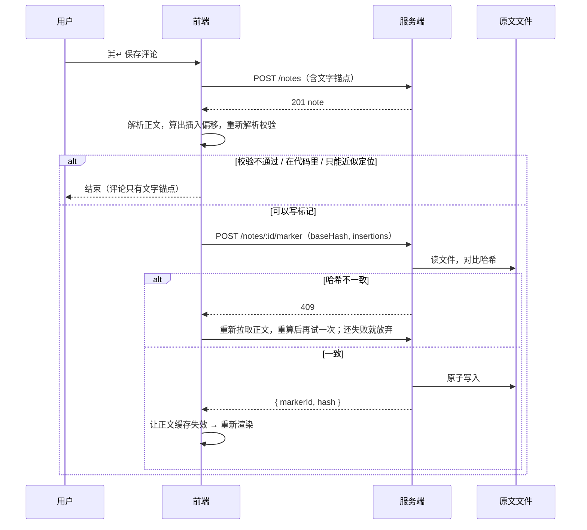

# 正文内嵌评论 + 点评论 + 原文锚点标记 设计文档

## 定位

评论（代码里叫 note）目前只能先选中文字再写，写完排在正文右侧的窄栏里，按锚点文字第一次出现的高度对齐。本设计做三件事：

1. 评论可以以横向长卡片的形式插进正文段落之间，从上往下一次读完；右栏保留，两种视图可切换。
2. 不选文字也能在正文某个位置插入评论（"点评论"）。
3. 原文会被小幅编辑，所以新建评论时往 Markdown 原文里插入不可见的注释标记，作为最稳的定位依据；标记丢失时退回文字匹配。

**主线：** 选区评论和点评论共用同一个锚点模型和同一个定位函数，两者只在"捕获时原文是否为空"一处不同。正文标记、内嵌卡片、右栏卡片高度这三处展示都只读取定位结果。原文标记是定位函数的第 0 步，标记丢了，评论退回文字定位，不会消失。

## 背景与现状

以下均为读代码确认（把握度：已读）。

- **评论数据**：`{ id, anchor, mediaTimestamp?, body, createdAt, updatedAt }`。`anchor` 就是选中文字的前 200 个字，为空表示"没有锚点"。
- **锚点捕获**：选区气泡点"添加笔记"时，取 `selection.toString().trim().slice(0, 200)`，没有任何上下文和位置信息。
- **锚点定位有两套实现，规则还不一样**：
  - 正文标记：把全文文本拼起来，找第一次出现（`indexOf`），能跨文本节点匹配。
  - 右栏卡片高度：逐个文本节点找第一次 `includes`，**不能**跨节点。选区横跨加粗或链接时，这里会定位失败，卡片被排到顶部。
  - 两套实现都有同一个问题：同一句话出现多次时，评论只会挂到第一处。
- **无锚点评论**：从右栏顶部输入框直接写的评论，`anchor` 为空，排在右栏最上面。
- **视频页**：
  - 视频在左的布局（Mode A）下，评论列表在左栏视频下方，不跟正文对齐。
  - 评论会记下当时的播放时间点。
  - "总结"和"文章"两个 tab 共用同一份评论数据。
- **双语文章**：评论文件放在"当前显示的那份 Markdown"旁边。译文出现后，页面改为显示译文，原文上写的评论就不再被读取。这是已有行为，本设计不处理。
- **正文渲染**：`MarkdownPreview` 内部是 react-markdown + remark-gfm，没有开启原始 HTML。**实测**：正文里的 HTML 注释 `<!-- … -->` 会被转义成字面文字显示出来，不会被隐藏。所以第 3 期的标记**必须**靠自定义插件在渲染前转换掉。
- **行首陷阱（实测）**：用项目里的 remark-parse 解析三种写法：
  - `hello <!-- sc:a -->world`：标记是段落内的行内 `html` 节点，段落完好。
  - `<!-- sc:a --> hello world`：整行变成 HTML 块，正文不再是段落。
  - `line1\n<!-- sc:a -->line2`：段落在这里被切成两段。

## 已确定的决策

| 议题 | 决定 |
|---|---|
| 卡片位置 | 插在锚点所在段落级元素的下方，不切开段落；正文里留行内标记（选区用底色，点评论用小图标） |
| 点评论入口 | 单击定位后按快捷键 `c`，或右键菜单"在此处评论" |
| 右栏 | 保留，"内嵌 / 右栏"两种视图可切换；默认内嵌，选择存在浏览器本地 |
| 折叠状态 | 不保存；打开页面时全部展开；单卡切换 + 全局"全部收起 / 全部展开" |
| 以后的功能 | AI 解释 / 问答、追加 / 回复、标签 / 引用、Markdown 正文。本次只把卡片按"外壳 + 条目"拆开，不实现这些功能 |
| 原文变化 | 只考虑小幅编辑，但被评论的文字本身也可能被改 |
| 锚点机制 | 原文标记优先，文字 + 位置兜底 |
| 文字都找不到时 | 按记录的位置放置，标为"近似" |
| 交付方式 | 一份总 spec，分三期实施，每期单独写计划、单独开分支 |

## 分期

| 期 | 内容 | 写原文 | 依赖 |
|---|---|---|---|
| 1 | 统一锚点模型、定位函数、三个创建入口、点评论图标；右栏改用新定位 | 否 | — |
| 2 | 内嵌卡片视图、卡片组件、视图切换、未定位区 | 否 | 第 1 期 |
| 3 | 原文标记的写入、删除和渲染识别，接到定位第 0 步 | 是 | 第 1 期 |

第 1、2 期做完就是一个完整可用的版本。第 3 期的风险最高，单独隔离，出问题可以单独回退。第 2、3 期之间没有依赖。

---

## 1. 锚点模型与定位

### 1.1 存什么

`Note` 新增以下可选字段，都是**纯增量**，现有 `notes.json` 不需要迁移：

| 字段 | 含义 | 出现时机 |
|---|---|---|
| `anchor`（已有） | 选中的原文，最长 200 字；点评论为空 | 已有 |
| `prefix` / `suffix` | 锚点前 / 后各最多 32 个字，**不跨段落**：碰到所在段落级元素的边界就停，可能不满 32 字甚至为空 | 第 1 期起的新评论 |
| `position` | 锚点起点在"正文文字索引"中的字符偏移 | 第 1 期起的新评论 |
| `doc` | `'summary'` 或 `'article'`，仅视频页记录锚点在哪个 tab | 第 1 期起的视频新评论 |
| `markerId` | 8 位十六进制，原文标记的编号 | 第 3 期写标记成功后由服务端写入 |

**锚点类型由字段推出**：
- `anchor` 非空：选区评论。
- `anchor` 为空，但 `prefix` 或 `suffix` 至少有一个非空：点评论。
- 都为空：无锚点评论。

前端只用一个判别函数来区分这三类，其他地方不再各自判断。

**截断约定**：选区超过 200 字时，`anchor` 取前 200 字，`suffix` 从**截断点**开始取（同样不跨段落）。也就是说，存下来的锚点就是这个截断后的范围。超出部分在文字兜底模式下不会被标记，和现在的行为一致。有标记时，范围以标记为准，不受截断影响。

**正文文字索引**：Markdown 正文渲染后，把所有文本节点按顺序拼起来，同时记录"第几个字在哪个节点、属于哪个段落级元素"。
- **不计入的内容**：
  - frontmatter 信息栏，这样改 frontmatter 不会让位置漂移。
  - 所有 Scholia 自己插入的界面元素（卡片、点评论图标、标记占位元素），这些元素统一带一个标识属性，收集时跳过。
- **段落级元素之间的分隔**：统一插入一个换行作为分隔符，原有空白不计入。这个分隔符只在"原文本身跨段落"时才会出现在 `anchor` 里。前后文不跨段，所以不会包含它。
- **捕获来源**：原文和前后文都从这份索引里按偏移截取，**不用**浏览器的"选区转文字"（`selection.toString()`）。这样捕获和查找走的是同一套规则。现有实现用"选区转文字"捕获，再拿拼接后的文本去查找，两边在段落之间的空白不一致，跨段落的选区评论很可能画不出标记（推测，未验证）。新做法顺带消除这个问题。

`position` 只是一个提示，用来在多个候选里挑最近的一个，以及作为最后的兜底；不要求精确。

### 1.2 定位顺序

输入：一条评论，以及当前正文的文字索引。输出：`{ start, end, grade }`，其中 `start` 和 `end` 是在文字索引里的偏移，点评论的 `start` 等于 `end`；或者返回"未定位"。

**基本规则：前文和后文各自独立判断，互不拼接。**
- **一侧"吻合"的定义**：存的这一侧为空，且候选在这一侧恰好是段落边界；或者，存的这一侧与候选紧邻的同侧文字（在同一个段落级元素内截取）完全相同。
- **边界线索**：存的一侧不满 32 字，说明当时碰到了段落边界。候选在这一侧也是段落边界时，算作额外的吻合线索。

| 步 | 条件 | 做法 | 档位 |
|---|---|---|---|
| 0 | 有 `markerId`，且正文里能找到对应的标记占位元素（第 3 期） | 范围取开头标记到结尾标记之间。只剩开头标记时，按 `anchor` 的长度推出结尾；只剩结尾标记时，向前推出开头 | 精确 |
| 1 | **选区评论**：`anchor` 在文字索引中原样出现 | 每个出现位置作为候选，分别检查左侧和右侧是否吻合。挑吻合侧数最多的；吻合侧数相同时，取离 `position` 最近的。旧评论没有前后文和位置，退化为取第一处，和现在的行为一致 | 精确（原文完好，前后文只用来挑候选） |
| 1 | **点评论**：`prefix` 和 `suffix` 中非空的那几侧，在同一个点上全部吻合 | 候选点取 `prefix` 原样出现处的终点，或者 `suffix` 原样出现处的起点。在这个点上，所有非空侧都吻合才算命中；有多处时取离 `position` 最近的 | 精确 |
| 2 | 第 1 步没命中，但有 `prefix` 或 `suffix` | **两侧分别**做近似查找，每侧最多允许长度 25% 的字符不同，并且只在单个段落级元素内部匹配；同等误差下取离 `position` 最近的一处。两侧都找到，且在同一个段落内、顺序合理（后文起点 ≥ 前文终点，间距不超过 `anchor` 长度 + 200），范围就是两者之间。只找到一侧，或两侧不在同一段时，以误差更小的那一侧为准，再按 `anchor` 长度推出另一端（不超出该段）。点评论取前文终点，或者后文起点。点评论只有一侧精确吻合、另一侧变了的情况，也归到这一步 | 近似 |
| 3 | 有 `position`，且不超过文字索引的总长度 | 在 `position` 处放一个**点**（不画选区底色，因为原文已不可信） | 近似 |
| — | 以上都不满足 | — | 未定位 |

**档位在界面上的表现**：

| 档位 | 界面表现 |
|---|---|
| 精确 | 正常显示 |
| 近似 | 卡片头部显示"原文已变化"提示，展开后能看到评论时的原文快照（`prefix` + `anchor` + `suffix`） |
| 未定位 | 进入文首的未定位区 |

**不跨段的代价**：
- 点评论落在段首或段尾时只有一侧上下文。
- 标题、短段落的上下文很短，同一句话出现多次时更多地依赖 `position` 来区分。
- 换来的好处是：相邻段落的任何改动都不影响这条评论的上下文。

**近似匹配库**：`approx-string-match`（MIT 许可，约 18KB，最近更新于 2026-10，已查证）。代价是前端多一个依赖。

**不做**：
- 不把近似找回的新位置自动写回 `notes.json`，以免一次错误的匹配被永久保存。
- 不做跨语言匹配。

**代价**：
- 每次渲染都要对每条评论跑一遍定位。按 `notes.json` 的规模（每篇几条到几十条）估计感觉不到。这是推测，没测过。
- 第 3 步可能把卡片放到不相关的段落，靠"近似"提示让用户发现。

---

## 2. 创建流程：三个入口合并（第 1 期）

### 2.1 入口

| 入口 | 产出 |
|---|---|
| 选区气泡里的"评论"按钮（已有） | 选区 |
| 在正文区右键，选"在此处评论" | 右键点在当前选区内时，用这个选区；否则用浏览器的"坐标 → 文字位置"接口（`caretPositionFromPoint` / `caretRangeFromPoint`），从鼠标坐标反推出插入点 |
| 快捷键 `c`（焦点在输入框或文本框时不触发，规则同现有的 `f`） | 当前的选区或光标位置 |

三个入口都调用同一个"捕获锚点"函数：输入一个 DOM Range，输出第 1.1 节定义的 `anchor / prefix / suffix / position / doc`。Range 收起成一个点时，`anchor` 为空。Range 落在 Markdown 正文之外（信息栏或卡片里）时，捕获失败，什么都不做。

捕获的结果成为"待写评论"，由页面统一持有，替换现在只存一段字符串的 `pendingAnchor`：
- **右栏视图**：沿用顶部输入框 + 锚点标签。点评论的标签显示"插入点：…前文末尾几个字"。
- **内嵌视图（第 2 期）**：在所在段落下方插入一张处于编辑状态的空白卡片。
- **保存与放弃**：⌘↵ 保存后提交 `POST /notes`（带上新字段）；Esc 放弃。

### 2.2 右键菜单

- 正文区右键改为自定义菜单，菜单项有"在此处评论"；点在高亮上时，还有"删除高亮"（已有功能，合并进同一个菜单）。
- **按住 Shift 右键**时不拦截，弹出浏览器原生菜单。
- 正文以外的区域，右键行为不变。
- **代价**：在正文里右键复制、查词会多一步。

### 2.3 未验证项

- 在不可编辑的正文里单击后，浏览器是否会留下一个可读取的收起选区（光标）。第 1 期实施的第一步就是验证这一点（Chrome、Safari）。如果不会，快捷键 `c` 只用于选区评论，点评论只能走右键。

---

## 3. 正文渲染管线

### 3.1 流程

正文或评论列表变化后，在一个统一的流程里依次执行：

1. **建文字索引**（第 1.1 节）。
2. **逐条定位**（第 1.2 节）。结果用偏移量表示，不用 DOM Range。因为后面包标记时会切分文本节点，Range 会失效；而偏移量对应的文字内容不变，所以每次注入前按偏移量重新解析到节点即可。
3. **画标记**：
   - 选区评论：复用现有的注入函数包上底色，输入从"一段文字"改为"一段偏移范围"。
   - 点评论：在该偏移处插入一个小图标元素。图标不含文字，并带有界面元素标识，不进入文字索引。
   - 按位置兜底找回的评论（第 1.2 节第 3 步）只画图标。
4. **插卡片槽位**（第 2 期，仅内嵌视图）：
   - 从锚点终点往上找最近的段落级祖先元素（`P / H1–H6 / LI / BLOCKQUOTE / PRE / TABLE`），在它后面插入一个带界面标识的空容器，用 React portal 把卡片渲染进去。
   - **列表项**：容器放在 `LI` 内部末尾，因为 `UL` 和 `OL` 的直接子元素只能是 `LI`。
   - **表格和代码块**：容器放在整个元素之后。
   - 同一个段落的多条评论共用一个容器，按 `start` 排序。
5. **右栏视图**：跳过第 4 步，用第 2 步得到的范围算出卡片的纵向位置，替代现有的高度计算函数。右栏卡片之间互不重叠的排布逻辑（`computePositions`）保持不变。

**高亮**：继续"按原文找第一次出现"，但改用同一份文字索引，行为不变。高亮要不要也用前后文和标记来定位，不在本次范围。

### 3.2 外来节点与 React 的冲突

现有的高亮注入已经在 react-markdown 渲染出来的 DOM 里切分文本节点。正文内容变化时，React 可能拿着旧节点去更新。这个隐患现在就存在，插入卡片容器会把它放大。

**对策**：`MarkdownPreview` 以正文内容为 `key`。内容一变就整棵重新挂载，注入流程始终在干净的 DOM 上从头执行，不在被改过的 DOM 上做增量更新。

**代价**：内容每变一次就整篇重建一次。内容只在切换 tab、文件被改、或第 3 期写标记后才会变化，正常阅读不受影响。

### 3.3 交互

- **点击正文标记或点评论图标**：内嵌视图下切换对应卡片的收起和展开；右栏视图下保持现在的行为（聚焦卡片并进入编辑）。
- **悬停联动**：保持现在的双向联动（标记 ↔ 卡片）。
- **收起状态**：只存在于当前页面的状态里；工具栏提供"全部收起 / 全部展开"。

### 3.4 未定位区（第 2 期，内嵌视图）

正文开头有一个可收起的"未定位评论（n）"区域，以及一个"添加评论"入口（新建无锚点评论；视频正在播放时自动带上时间点）。区域里放三类评论：

- 无锚点评论
- 定位结果为"未定位"的评论
- 视频页中 `doc` 与当前 tab 不同的评论。没有 `doc` 字段的旧评论仍在当前 tab 里尝试定位。

---

## 4. 卡片组件与视图切换（第 2 期）

### 4.1 卡片结构

| 部位 | 本次 | 以后 |
|---|---|---|
| 头部 | 折叠箭头、类型图标（选区 / 点）、锚点摘录（选区评论显示原文首行，点评论显示"插入点"）、视频时间点、"原文已变化"提示、时间、编辑 / 删除 | 标签 |
| 内容区 | 条目列表，目前只有一条，由 `note.body` 转换而来 | 回复、AI 回答依次追加；条目带类型 |
| 底部 | 不渲染 | "问 AI"、引用等操作 |

- 组件按"外壳 + 条目"拆分。以后加功能只需要往条目列表里加条目、给条目加类型；要支持 Markdown 渲染，只需要改"单条条目"这一个组件。
- **数据模型这次不动**：不给 `notes.json` 预先加条目列表字段。
- **收起时**：只显示头部这一行。

### 4.2 两种视图共用同一个组件

- 新卡片组件带一个参数，取值为"内嵌"或"右栏"：内嵌版是横向长卡片，右栏版保持现在的窄卡片。编辑、保存、删除、悬停联动的逻辑只写一份。
- 现有右栏里的 `NoteItem` 被新组件取代。
- **代价**：以后加的功能必须能放进右栏 260px 的宽度。

### 4.3 视图切换

- `ui-store` 新增"评论视图"状态，取值为内嵌或右栏，存在浏览器本地（沿用现在排序状态存本地的方式），默认内嵌。
- 切换开关放在顶部工具栏，紧挨着主题选择器。
- 内嵌视图下隐藏右栏，正文宽度不变。
- **Mode A**：左栏视频下方的评论列表不变。内嵌视图下，同一条评论会在左栏和正文里各出现一次，两处分别服务按时间看和按正文看。这一点先接受，觉得重复碍眼的话，以后改为内嵌视图下隐藏左栏列表。

---

## 5. 原文标记（第 3 期）

### 5.1 标记格式

| 类型 | 写法 |
|---|---|
| 点评论 | 在插入点写 `<!-- sc:3f9a2b1c -->` |
| 选区评论 | 开头写 `<!-- sc:3f9a2b1c -->`，结尾写 `<!-- /sc:3f9a2b1c -->`，可以跨段落 |

编号 `markerId` 由服务端生成，在同一个文件内唯一。

### 5.2 分工

**前端（算出插在哪里）**：

1. 用**和渲染器同一套**解析器（`unified` + `remark-parse` + `remark-gfm`，版本与 `markdown-preview-core` 对齐，作为 web 的直接依赖加入）解析当前正文，得到每个节点在源文件里的位置。
2. 从解析结果里的 `text` 和 `inlineCode` 等文本节点，拼出一份"源文件文字索引"。拼的时候记下每个字对应的源文件偏移。节点内容和源文件片段不能逐字对应时（比如转义符、HTML 实体），这个节点只用于匹配，不允许在里面插入标记。
3. 在这份索引上再跑一遍第 1.2 节的定位函数。**只有精确档才写标记**，近似档不写，避免把标记写到错的地方。
4. 换算出插入偏移后，套用行首规则：
   - 结尾标记如果落在行首，改放到上一行的行尾。
   - 开头标记或点标记如果落在行首，往后挪一个字。
5. **插入后重新解析校验**：每个标记必须是段落、标题或表格单元格内（包括嵌套在加粗、链接里）的行内 `html` 节点，且顶层块的数量和类型序列与插入前相同。不通过就放弃写标记。
6. 锚点落在 `code`、`inlineCode` 节点内时，放弃写标记。

**后端（按指令写入）**：

新接口 `POST /api/tasks/:taskId/notes/:noteId/marker`，请求体为 `{ baseHash, insertions: [{ offset, edge: 'start' | 'end' | 'point' }] }`。

1. **定位文件**：文章取当前显示的 `.md` 文件；视频按评论的 `doc` 字段，取 `writing/summary.md` 或 `writing/article.md`。
2. **校验版本**：计算"前端拿到的正文"的哈希（对 UTF-8 编码取 SHA-256，转成十六进制；前端用 `crypto.subtle` 按同样方式计算）并与 `baseHash` 比较。文章的正文是去掉 frontmatter 之后的部分，视频的正文是整个文件，和 `/result/content` 返回的内容一致。不一致就返回 409。
3. **校验偏移**：偏移越界或 `edge` 组合不合法（选区必须恰好有一个开头和一个结尾，点评论恰好一个点）时，返回 400。
4. **生成标记**：服务端生成 `markerId`，并**自行拼出**标记文本，不接受客户端传来的任意字符串。
5. **写入**：按偏移从大到小插入（文章要先加上 frontmatter 的长度）。用临时文件 + rename 原子写入，临时文件名要唯一，避免并发写入时撞名。
6. **回写评论**：把 `markerId` 写进这条评论，返回 `{ markerId, hash }`。

**删除评论**：`DELETE /notes/:noteId` 在评论带有 `markerId` 时，额外在对应文件里删除所有匹配 `<!-- /?sc:<markerId> -->` 的注释。删除只认这个固定格式，所以即使文件在这期间被改过也是安全的。

### 5.3 时序与失败状态

- **先存评论，再写标记**：写标记失败时，评论退回文字定位，用户无感。反过来先写标记的话，失败会在原文里留下一个没有对应评论的孤儿标记。
- **写标记不提示用户**：成功或失败都不弹提示。后续可以在卡片上显示一个"已锚定到原文"的小标记，本次不做。

### 5.4 渲染识别

新增一个 remark 插件，通过 `MarkdownPreview` 的 `remarkPlugins` 挂载：
- 把匹配 `^<!--\s*(/?)sc:([0-9a-f]{8})\s*-->$` 的 `html` 节点转换成空的 `span`，带编号、端点类型（开头 / 结尾 / 点）和界面元素标识。
- 定位第 0 步就是在正文里找这些占位元素。
- 编号查不到对应评论的占位元素（比如评论被手动删除）直接忽略。
- 同一个编号出现多次（比如复制粘贴了一段）时，取第一处。
- 其他 HTML 注释保持现状，仍然转义成字面文字显示，不在本次范围。

### 5.5 项目约定变更

`CLAUDE.md` 和 `server/paths.js` 里"文章文件永不移动、改名或修改"这条，改为：

> 文章文件不移动、不改名；Scholia 只会在其中插入和删除 `<!-- sc:… -->` / `<!-- /sc:… -->` 评论标记，不做其他修改。

### 5.6 已知风险

| 风险 | 后果 | 处理 |
|---|---|---|
| Obsidian 正在编辑同一篇文章，且还没自动保存 | 哈希校验拦不住这一两秒的窗口；Obsidian 读到外部修改后如何合并，**未查证** | 接受；实施时手动测一次 |
| 视频文稿被重新生成 | 标记全部丢失 | 退回文字定位 |
| 每次增删评论都会改原文 | 触发 iCloud 或 Obsidian Sync 同步，文件修改时间变化 | 接受 |
| 前端判断"可以插入"，但实际渲染出了问题 | 后端只保证格式合法，不保证位置合理 | 插入后重新解析校验 + 测试覆盖行首、列表、引用等场景 |

---

## 6. 测试

### 6.1 前端单元测试（vitest + jsdom）

- **捕获和定位**（纯函数，输入是 DOM 或文字索引）：
  - 精确匹配、原文多处出现时按前后文和位置挑选、原文被改、前后文部分被改
  - 点评论、只有一端能找到
  - 旧评论（只有 `anchor`）、按位置兜底、未定位
- **前后文不跨段**：
  - 锚点在段首、段尾时，前文或后文被边界截短甚至为空
  - 相邻段落被修改后，仍然精确命中
  - 只有一侧吻合的点评论归为近似
  - 近似查找不会跨段命中
- **文字索引**：
  - 跳过界面元素和信息栏
  - 跨加粗或链接的选区
  - 跨段落的选区：分隔符统一；捕获和查找结果一致
- **源文件映射与插入**（第 3 期）：
  - 已实测的三种行首情况，以及列表项开头、引用块开头
  - 行内代码和代码块（必须放弃写标记）、转义符
  - 插入后重新解析校验失败的路径
- **jsdom 的限制**：没有排版，也没有 `caretRangeFromPoint`，所以坐标反推插入点用 mock，纵向位置不在单元测试里验证。

### 6.2 组件测试

- **入口**：选区气泡、右键菜单（包括 Shift 放行原生菜单）、`c` 键（在输入框里不触发）。
- **槽位位置**：内嵌卡片分别插在 `p`、`li`（内部末尾）、`table` 之后。
- **卡片行为**：收起和展开、全部收起、待写评论卡片的保存和放弃。
- **其他**：视图切换及其本地保存；未定位区里的三类评论。

### 6.3 后端测试（`tests/server.test.js`）

- **`POST /notes` 新字段**：保存和回读 `prefix / suffix / position / doc`，非法值返回 400；不带新字段的旧请求行为不变。
- **marker 接口**：
  - 正常写入（文章需保留 frontmatter；视频按 `doc` 选文件）
  - 哈希不一致返回 409；偏移越界或端点组合非法返回 400
  - 写入的标记文本由服务端生成
- **删除**：带 `markerId` 的评论被删除时，同时删掉原文里的标记；不带时不碰原文。

### 6.4 手动验收

- **真实文章**：在 Obsidian 里改评论附近的文字、改被评论的文字、删掉标记，分别检查卡片是"精确"、"近似"还是退回文字定位。
- **并发编辑**：Obsidian 打开同一篇文章时新建评论，观察外部修改的提示与合并行为（对应第 5.6 节的未查证项）。

---

## 不做

- 跨语言定位，以及原文切换成译文后评论文件位置变化的问题。
- 高亮改用前后文或标记定位。
- 卡片里的 AI 问答、回复、标签和引用、Markdown 渲染（本次只拆好结构）。
- 折叠状态持久化。
- 自动把近似找回的位置写回 `notes.json`。
- 其他 HTML 注释被转义显示的已有问题。

## 未确认项汇总

| 项 | 影响 | 何时确认 |
|---|---|---|
| 在不可编辑正文里单击后，是否留下可读取的光标 | 快捷键 `c` 能否用于点评论 | 第 1 期第一个任务。**实测 2026-10-22**：Chrome（HeadlessChrome 145）单击正文后 `getSelection()` 为 `["Caret", true, "#text", 59]`，可用。Safari 待用户实测 |
| Obsidian 对外部修改的合并行为 | 第 3 期并发编辑的风险程度 | 第 3 期手动验收 |
| 定位的性能 | 评论多、文章长时是否卡顿；目前是推测，不会卡 | 第 1 期用最长的一篇文章实测。**实测 2026-10-22**：160 KB 的文章（正文 76,347 字符、1,245 个块）、30 条评论（18 条选区、8 条点、4 条旧评论，全部定位成功）加 5 条高亮，一次完整注入（建索引、定位、插入标记和图标）6 次加载为 24.0 / 25.05（中位）/ 25.3 ms，高亮注入约 5 到 6 ms；低于 100 ms 的预期。无头 Chromium、开发机，不代表低端设备 |
| 译文与原文的段落结构对不上 | 只看了一个样本（原文约 14 段、译文约 35 段），用来说明"不能按段落映射" | 不影响本设计 |

## 代码锚点

- 评论数据结构：`server/index.js:343`、`web/src/lib/api.ts:157`
- 评论增改接口：`server/index.js:334`、`server/index.js:349`
- 删除接口：`server/index.js:363`
- 选区捕获：`web/src/components/reader.tsx`（`handleMouseUp`）
- 标记注入：`web/src/components/reader.tsx`（`injectAnchorMarks`）
- 右键菜单：`web/src/components/reader.tsx`（`handleContextMenu`）
- 右栏定位与排布：`web/src/components/notes-panel.tsx`（`resolveAnchorY`、`NotesPanel`）
- 右栏卡片排布算法：`web/src/lib/anchor-layout.ts`
- 页面状态与布局：`web/src/routes/tasks.$id.tsx`
- 快捷键：`web/src/hooks/use-hotkeys.ts`
- 视图状态存本地的写法参考：`web/src/stores/ui-store.ts`（`readSortState`）
- 布局样式：`web/src/styles/globals.css:220` 起（`.notes-col` 和各 Mode）
- 正文读取：`server/index.js:251`、`server/article-source.js:14`（frontmatter 剥离）、`server/video-source.js:111`
- 原子写入：`server/index.js:28`（`writeJson`）
