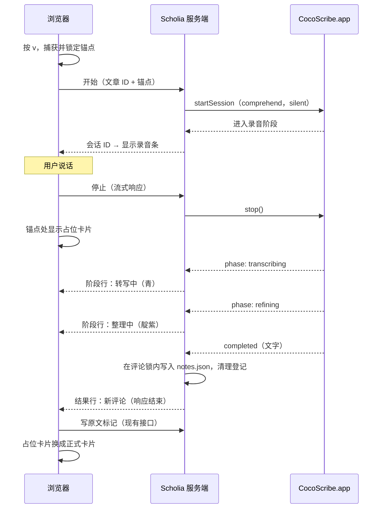

# 语音评论（第一期）设计文档

## 定位

读文章时，选中一段文字（或在某处点一下）按 `v`，直接把想法说出来；说完再按 `v`，这段话经 CocoScribe 转写并整理后，自动存成锚定在那段文字上的评论。它是现有评论的第四个创建入口，只把"正文"的来源从键盘换成了语音，锚点、存储、原文标记、卡片展示全部沿用现有机制。

没有它的时候，读者要在"想"和"打字"之间来回切换，边读边想的那一刻往往因为打字成本被放弃；它解决的是"批注的输入成本"，不是"批注的形态"。

**主线：** 语音评论在开始录音时捕获锚点、在服务端拿到最终文字后按普通评论落盘，除"正文从哪来"之外不新增任何数据字段和定位规则；CocoScribe 不可用时，这个入口整体失效而手动批注不受任何影响。

Scholia 的整体定位与"为什么不另起项目"见 [../../adr/2026-11-02-scholia-positioning.md](../../adr/2026-11-02-scholia-positioning.md)。

## 背景与现状

把握度分三档：**已读**（读代码或文档确认）、**推断**（从已读内容推出，未实测）、**未查**。

### Scholia 侧（已读）

- **评论数据**：`{ id, anchor, prefix?, suffix?, position?, doc?, markerId?, mediaTimestamp?, body, createdAt, updatedAt }`。`anchor` 非空是选区评论，空但有 `prefix`/`suffix` 是点评论。
- **评论创建入口有三个**，都先捕获锚点再打开输入框：选区气泡、`c` 快捷键（有选区评选区、没选区评光标处）、右键菜单"在此处评论"。三者都走同一个锚点捕获函数。
- **原文标记由前端写**：评论保存成功后，前端拿缓存的原文内容规划插入位置，再调服务端的标记接口；原文在这期间被改过会重新拉一次内容重试一次，失败就放弃，评论退回文字定位。
- **`notes.json` 的所有读改写都串行在同一把锁里**，避免并发请求互相覆盖。
- **没有服务端推送**：前端有一个 SSE 客户端，但服务端没有对应路由，前端注释里写明它一直处于失效状态。
- **快捷键 `v` 未被占用**；`c`、`Esc`、`Cmd/Ctrl+K`、`Cmd/Ctrl+Enter` 已被使用。
- **私有包**：前端已经依赖一个 GitHub Packages 私有包（`markdown-preview-core`）。根目录 `postinstall` 会先给 `web/` 写一份指向私有源的 `.npmrc` 再装前端依赖；根目录本身没有 `.npmrc`，本机用户级 `~/.npmrc` 只有 token、没有 `@harveyzhang814` 的源映射。

### CocoScribe SDK 侧（已读，来源：SDK 自带 README，CocoScribe 仓库规定它是外部接入的唯一指南）

- SDK（`@harveyzhang814/host-client`）是 Node 端 CommonJS 客户端，经本机 Unix socket 驱动常驻的 CocoScribe.app。录音、转写、整理都在 CocoScribe 里完成；宿主不碰麦克风，也不需要麦克风权限。**浏览器无法直接使用**，只能放在 Scholia 服务端。
- 一次会话：`startSession` → 录音直到宿主显式调用 `stop()`（CocoScribe 不会因静音自动停）→ 转写 →（comprehend 模式下）整理 → `completed` 给出最终文字。超过 10 分钟 CocoScribe 自动取消，以 `timeout` 失败。
- **结果只有文字**：`text`、`rawTranscript`、`durationSeconds`、`edited`，没有音频文件路径。CocoScribe 自己会清理 7 天前的录音。
- **只有粗粒度阶段事件**，说话过程中没有任何中间文字；连续录音模式停止时也只给一整段文字。
- **麦克风独占**：同一时刻只能有一个会话在录音，否则 `busy`；上一个停止录音后、还在处理时，可以开始下一个。
- **两类错误**：传输错误（CocoScribe 没运行，`app_not_running`）走 `error` 事件；会话错误（`busy`、`no_audio`、`transcription_failed`、`timeout`、`cancelled` 等）走 `failed` 事件。
- **重试**：失败时若错误带 `taskId` 且 `canRetry`，可以 `retryTask(taskId)`，它重新处理 CocoScribe 已保存的录音或转写，不录音、不占麦克风。需要 CocoScribe.app ≥ 7.1.0。
- `silent: true`（默认）隐藏 CocoScribe 自己的菜单栏动画和浮窗，宿主界面是唯一的进度显示；macOS 系统的麦克风指示灯仍会出现。
- 宿主进程中途退出，CocoScribe 仍会在后台把会话处理完，结果留在 CocoScribe 的历史里。

## 已确定的决策

| 议题 | 决定 |
|---|---|
| 项目归属 | 在 Scholia 内升级，不另起项目（理由见 ADR） |
| 内容范围 | 只做文章（含双语条目），不做视频 |
| 交互模型 | 第一期"先选再说"；"持续监听"是第二期 |
| 开始 / 停止 | 切换式：`v` 开始，再按 `v` 停止并保存，`Esc` 取消；选区气泡和右键菜单各加一个"语音评论" |
| 录完之后 | 直接保存为评论，不经草稿确认；要改就在卡片里像普通评论一样改 |
| 转写模式 | comprehend（转写 + Ollama 整理），只存整理后的文字，不存原始转写 |
| 音频 | 不保留 |
| 卡片标识 | 不区分语音评论和手写评论 |
| 失败重试 | 放进第一期 |
| 录音时关页面 | 不做专门处理，靠 CocoScribe 10 分钟超时兜底 |
| 处理阶段 | 区分"转写中"和"整理中"；靠"停止"请求的流式响应把阶段推给浏览器，不建全局推送通道 |
| 录音动效 | 闪烁圆点 + 计时，不画波形（拿不到真实音量，假波形会和 `no_audio` 失败自相矛盾） |
| 阶段颜色 | 沿用 CocoScribe 悬浮窗的颜色语言：录音珊瑚、转写青、整理靛紫、完成绿；失败用 Scholia 自己的 `status-err` |
| CocoScribe 设置冲突 | 首次录音时一次性提示用户关掉 CocoScribe 的"转录完成后弹出编辑窗口"和"Copy transcript to clipboard"；README 同步写明 |

## 交互

### 入口

| 入口 | 条件 | 锚点 |
|---|---|---|
| `v` 键 | 焦点不在输入框 / 评论卡片里 | 有选区 → 选区评论；无选区 → 光标处点评论（与 `c` 完全相同的判定） |
| 选区气泡"语音评论"按钮 | 有选区 | 选区评论 |
| 右键菜单"语音评论" | 同"在此处评论" | 同"在此处评论" |

- 只在文章页出现；视频页不显示这些入口，`v` 也不响应。
- CocoScribe 不可用时，气泡和菜单项置灰，悬停提示"CocoScribe 未运行"；按 `v` 弹一条同样内容的轻提示。可用性在进入文章页时检查一次，之后每次开始失败时刷新。
- 锚点在**按下开始的那一刻**捕获并锁定；录音过程中选区变化、页面滚动都不影响这条评论挂在哪。

### 录音中

- 正文区顶部出现录音条：珊瑚色闪烁圆点 + 计时 + 锚点原文 + "`v` 结束 · `Esc` 取消"，底色是极淡的珊瑚色。录音条在页面滚动时保持可见。被锁定的锚点文字显示珊瑚色虚线底。
- 不画波形：SDK 不提供音量，本地生成的假波形在用户没出声时照样跳动，最后却报"没有录到声音"，自相矛盾。
- **首次录音**时录音条下方多一行一次性提示（存浏览器本地，点"知道了"后不再出现），原因见下方"与 CocoScribe 设置的冲突"。
- 录音中再次按 `v`（或点录音条上的"结束"）= 停止并保存；`Esc`（或点"取消"）= 丢弃，不产生任何评论。
- 录音中气泡和右键菜单里的"语音评论"置灰（麦克风独占，第二段录音必然 `busy`）。手动评论入口不受影响。

### 停止之后

1. 锚点位置立刻出现一张占位卡片：内嵌视图里出现在锚点段落下方，右栏视图里按锚点高度对齐——和一条普通评论的位置完全一样。
2. 卡片随阶段变化：先是"**转写中…** → 整理"（青色虚线边框、青色转圈和麦克风图标），再是"转写 → **整理中…**"（靛紫色），右侧显示录音时长。两次阶段事件之间只有转圈动画表示"还在工作"，不伪造逐字或百分比进度。
3. 处理期间可以立刻开始下一段录音，所以同一页面上可能同时有多张占位卡片。
4. 成功：卡片边框闪一下绿色，然后就是一张普通评论卡片，原文标记照常写入。
5. 失败：占位卡片变成错误状态（红色边框），显示一句原因（见下方失败表），按钮为"重试"（仅可重试时出现）和"丢弃"。重试时卡片回到"转写中"。

阶段色只用在圆点、边框、图标和转圈上，不用于文字：这几种亮色在浅色背景上当文字对比度不够。

占位卡片只存在于当前页面的内存里，不落盘。

## 架构

### 部件与信任关系

| 部件 | 职责 | 不信任谁 / 防什么 |
|---|---|---|
| 浏览器 | 捕获锚点、驱动开始/停止/取消/重试、显示录音条和占位卡片、成功后写原文标记 | 不假设 CocoScribe 一定在；任何请求失败都只影响这张占位卡片 |
| Scholia 服务端语音模块 | 持有 SDK 客户端；内存里登记进行中的会话及其锚点；会话成功时按普通评论落盘 | 不信任浏览器传来的锚点（与现有建评论接口同样校验）；不假设浏览器会来调"停止"（会话终止时自行清理登记） |
| CocoScribe.app | 录音、转写、整理；超时兜底 | — |

- SDK 只在服务端使用，这是 SDK README 对"渲染层无 socket 访问"宿主（以 Electron 为例）的推荐结构，Scholia 的"浏览器 + 本地 Node 服务"是同一形态。
- 评论在**服务端**落盘，所以"停止"之后关掉页面，评论仍会保存；只是原文标记没人写，这条评论退回文字定位（与现有"标记写失败"的退化路径相同）。
- 进行中的会话只登记在服务端内存。Scholia 重启会丢掉登记：正在录音的会被 CocoScribe 10 分钟超时收掉，正在处理的结果只留在 CocoScribe 历史里，不会进 Scholia。

### 接口

所有接口沿用现有的 Bearer token 鉴权。

| 接口 | 作用 | 何时返回 |
|---|---|---|
| `GET /api/voice/status` | CocoScribe 是否可连 | 立即 |
| `POST /api/voice/sessions` | 开始录音；请求体是文章 ID + 捕获好的锚点 | 等到 CocoScribe 确认进入录音阶段，或明确失败 |
| `POST /api/voice/sessions/:id/stop` | 停止录音并等待结果 | 流式响应：每进入一个阶段推一行，终止时最后一行是新建的评论，或错误码和重试信息 |
| `DELETE /api/voice/sessions/:id` | 取消（丢弃）录音中的会话 | 立即 |
| `POST /api/voice/retry` | 重试一次失败；请求体是文章 ID + 锚点 + CocoScribe 的 `taskId` | 同"停止"：流式推阶段直到终止 |

- **重试不依赖服务端登记**：失败时服务端把 CocoScribe 的 `taskId` 和锚点一并交回浏览器后就清掉登记；重试由浏览器带着它们重新发起。这样服务端只登记"进行中"的会话，任何终止事件都会清理登记，不存在"失败会话无人认领、永久占内存"的情况。
- **开始接口要等 CocoScribe 确认**：SDK 的 `startSession` 同步返回，"没运行""麦克风忙"都是之后异步到达的事件。开始接口等第一个"进入录音阶段 / 失败 / 传输错误"再回应，浏览器才能可靠地决定是显示录音条还是报错。
- **停止和重试是流式响应**：一行一个 JSON（换行分隔），先是若干条阶段（`transcribing`、`refining`），最后一条是结果（评论）或失败（错误码、`taskId`、能否重试）。整个响应持续到会话终止，时长 = 转写 + Ollama 整理，取决于 CocoScribe 的模型配置，可能几秒到几十秒（推断，未实测）。
- **流式响应的代价**：HTTP 状态码在第一行之前就发出了，所以会话层面的失败不能靠状态码表达，只能看最后一行；浏览器要按行读取响应体，不能直接当 JSON 解析。只有请求本身不合法（找不到会话、ID 不对）才用非 200 状态码直接返回。
- **为什么不建全局推送通道**：阶段只对发起"停止"的那个请求有意义，跟在那个请求上推最直接；全局通道要处理多标签页、重连、事件归属，是第二期"持续监听"才需要的东西。
- 只接受 `article-` 前缀的 ID，其余返回 400。
- 新建评论的落盘逻辑从现有"建评论"接口中抽出共用，保证校验、锁、字段与手动评论完全一致；评论正文为空（整理后文字为空）按失败处理。

### 时序

## 失败处理

| 在哪失败 | 原因 | 浏览器看到 | 之后的状态 |
|---|---|---|---|
| 开始 | CocoScribe 没运行 | 轻提示"CocoScribe 未运行"，入口置灰 | 没有会话、没有卡片 |
| 开始 | CocoScribe 正在录另一段（`busy`） | 轻提示"CocoScribe 正在录音" | 同上 |
| 录音中 | 用户按 `Esc` | 录音条消失 | 什么都不留 |
| 录音中 | 页面被关 / 刷新 | — | CocoScribe 录满 10 分钟后以 `timeout` 结束，服务端清理登记，不产生评论 |
| 处理中 | 没录到声音 | 错误卡片"没有录到声音"，只有"丢弃" | 用户丢弃前卡片保留在当前页面 |
| 处理中 | 转写或整理失败（如 Ollama 不可用） | 错误卡片"转写或整理失败"；可重试时有"重试" | 同上 |
| 处理中 | CocoScribe 中途退出 | 错误卡片"CocoScribe 连接中断"，只有"丢弃" | CocoScribe 重启后结果可能在它自己的历史里，Scholia 不去找回 |
| 处理中 | Scholia 服务重启 | 停止请求失败，错误卡片"连接中断" | 同上 |
| 成功后 | 原文标记写失败 | 无提示（与手动评论一致） | 评论已保存，退回文字定位 |

## 与 CocoScribe 设置的冲突

以下来自 CocoScribe 的 `docs/explanation/embedded-vs-native-capabilities.md`（已读），Scholia 读不到也改不了 CocoScribe 的设置：

- `silent: true` 只隐藏录音时的菜单栏动画和悬浮窗，**不隐藏 CocoScribe 的结果编辑窗口**。用户若开着"转录完成后弹出编辑窗口"，每条语音评论结束后 CocoScribe 自己的窗口都会弹出来。
- 用户若开着"Copy transcript to clipboard"，每条语音评论的文字都会写进剪贴板，覆盖用户原有的剪贴板内容。
- 语音评论也会出现在 CocoScribe 的任务历史里。这一条不影响使用，只在 README 里说明。

处理方式：首次录音时在录音条下方显示一次性提示，点名这两个开关；README 的安装一节同样写明。

## 设计规范变更

实施时要同步更新 `DESIGN.md` 和 `web/src/styles/globals.css`：

- 新增四个阶段色 token（录音 `#FF6B47`、转写 `#20D5C4`、整理 `#8B5CF6`、完成 `#34D399`，明暗模式同值），注明来源是 CocoScribe 悬浮窗、只用于非文字元素。
- `DESIGN.md` 现有"全站没有紫色"的说法要加一条例外：靛紫只作为 CocoScribe 的"整理中"阶段色出现在语音占位卡片上。

## 边界（第一期不做）

- 视频页的语音评论。
- 保留音频、存原始转写、在卡片上区分语音与手写。
- 保存前的草稿确认（SDK 的 `awaitEdit`）。
- 全局的服务端推送通道（阶段只在停止 / 重试请求的流式响应里推）。
- 录音波形、逐字转写预览、阶段内进度百分比。
- 录音时关页面的主动取消。
- 持续监听（第二期，前置条件见下）。

## 第二期的前置条件（记录，不在本期实施）

"持续监听"要求阅读期间麦克风常开，每段话按说话时的阅读位置自动挂到原文上。当前 SDK 做不到：连续模式停止时只给一整段文字，没有分段事件和分段时间。因此第二期依赖两件本期之外的事：

1. CocoScribe socket 协议与 SDK 增加"每段结果"推送（CocoScribe 仓库的工作）。
2. Scholia 补上全局的服务端推送通道（本期只在停止 / 重试请求上做了流式响应）。

## 安装与分发

- 根目录 `package.json` 新增 SDK 依赖；根目录提交一份 `.npmrc`，只写 `@harveyzhang814` 的源映射，token 仍来自用户级 `~/.npmrc`。
- **全局安装风险（推断，需实测）**：`release:local` 是先打包再全局安装 tarball。现有私有前端依赖之所以能装上，是因为 `postinstall` 在装 `web/` 之前临时写了 `web/.npmrc`；根目录依赖在 `postinstall` 之前就要解析，tarball 里也不带根目录 `.npmrc`，全局安装大概率在拉 SDK 时失败。建议用 `bundleDependencies` 把 SDK 直接打进 tarball（SDK 没有运行时依赖，打进去的只有它自己）；实施计划第一步先实测这一点，不行再退回"要求用户在 `~/.npmrc` 加源映射"并写进 README。
- 运行时要求 CocoScribe.app ≥ 7.1.0（重试需要）。README 的安装一节补上这条和"语音评论需要 CocoScribe 运行"。

## 测试策略

- **服务端**（沿用 `tests/server.test.js` 的风格）：通过 `createApp` 的选项注入一个假的 SDK 客户端（可控地发 `phase`/`completed`/`failed`/`error` 事件），不依赖真实 CocoScribe。覆盖：
  - 开始：成功；没运行 → 对应错误；`busy` → 对应错误；非文章 ID → 400；锚点校验与手动建评论一致。
  - 停止：响应按顺序推出阶段行，最后一行是评论；成功 → `notes.json` 多一条、字段与手动评论一致；整理后文字为空 → 最后一行是失败；`failed` 带 `taskId`/`canRetry` → 原样交回。
  - 取消：会话结束、不产生评论。
  - 重试：成功 → 落盘；再次失败 → 交回新的 `taskId`。
  - 登记清理：任意终止事件（含无人调停止的超时）后登记为空。
  - 并发：一条语音评论落盘与一条手动评论落盘同时发生，两条都在。
- **前端**（vitest）：`v` 开始/停止、`Esc` 取消、输入框里按 `v` 不触发、视频页不响应；录音中语音入口置灰；按行解析流式响应（含一行被拆成两个分块到达）；占位卡片的转写中 / 整理中 / 失败 / 重试 / 丢弃状态；首次提示只出现一次；CocoScribe 不可用时入口置灰。
- **真机验收**（追加到 `docs/acceptance-testing.md`）：真实 CocoScribe 下跑一遍选区和点评论各一次；停掉 Ollama 触发整理失败后重试成功；退出 CocoScribe 后入口置灰、手动评论照常。

## 风险

| 风险 | 影响 | 缓解 |
|---|---|---|
| 全局安装拉不到私有 SDK | `release:local` 装不上，整个 Scholia 不可用（不只是语音功能） | 计划第一步实测，`bundleDependencies` 优先 |
| 停止请求持续过久 | 占位卡片长时间停在某个阶段 | 阶段可见，用户能看出是卡在转写还是整理；CocoScribe 的 10 分钟超时是上限 |
| 用户没关 CocoScribe 的编辑窗口 / 自动复制 | 每条语音评论都弹窗、覆盖剪贴板 | 首次录音提示 + README |
| `v` 键误触 | 不想录音时开了麦克风 | 录音条醒目、系统麦克风指示灯也会亮，`Esc` 一键丢弃 |
| comprehend 整理改变原意 | 评论内容和说的不一致，且原始转写不保存 | 决策时已接受；卡片可直接编辑 |

## 未确认项汇总

- **推断**：开始录音后 SDK 会先发出"进入录音阶段"事件，可作为开始接口的返回时机（依据是 README 的阶段图，未实测）。
- **推断**：停止到出结果的耗时量级（几秒到几十秒）。
- **推断**：`release:local` 全局安装在不做处理时会拉不到 SDK；`bundleDependencies` 能解决。
- **未查**：本机 CocoScribe.app 的版本是否 ≥ 7.1.0。
- **未查**：本机 CocoScribe 的理解模型（Ollama）是否已配置可用。

## 代码锚点

- 评论建、改、删与标记接口：`server/index.js:372`、`server/index.js:418`
- 评论锁：`server/index.js:91`
- 锚点捕获：`web/src/lib/anchor.ts:19`
- `c` 键入口：`web/src/components/reader.tsx:234`
- 选区气泡：`web/src/components/reader.tsx:127`
- 设计稿：`.hskill/sync-design/html/drafts/task-detail-article-web-design.html`
- CocoScribe 阶段色出处：`~/Projects/cocoScribe/docs/explanation/float-window-architecture.md`；宿主进度界面建议：`~/Projects/cocoScribe/docs/explanation/host-progress-ui-patterns.md`
- 保存后写原文标记：`web/src/hooks/use-tasks.ts:79`、`web/src/lib/marker-write.ts:16`
- 失效的 SSE 客户端：`web/src/lib/sse.ts:24`
- 私有源写入：`package.json` 的 `postinstall`
- SDK 接入指南：`~/Projects/cocoScribe/packages/host-client/README.md`（CocoScribe 侧说明见 `~/Projects/cocoScribe/docs/how-to/embed-with-host-client-sdk.md`）
